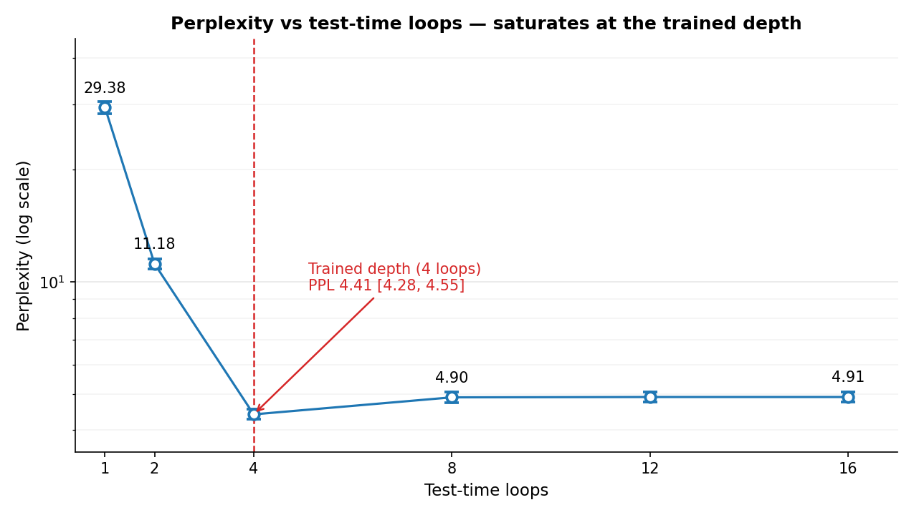

# Recurrent Small Language Models

*Architecture, Training, and Evaluation — A Technical Report*

The full report is at
[report/Recurrent_Small_LMs_Technical_Report_NeurIPS.pdf](report/Recurrent_Small_LMs_Technical_Report_NeurIPS.pdf)
(22 pages, two-column; LaTeX sources in `report/`). This README states
the one executed result and what the report does and does not claim.

## Question

Do recurrent transformers gain anything from running extra loops at test
time?

## Answer

No. Perplexity falls from 29.4 to 4.4 as loops go from 1 to 4 (the trained
depth), then flatlines — 8, 12, and 16 loops buy nothing, and going past
the trained depth slightly degrades performance.


| Loops | 1 | 2 | **4 (trained)** | 8 | 12 | 16 |
|---|---|---|---|---|---|---|
| Loss | 3.380 | 2.414 | **1.484** | 1.590 | 1.591 | 1.591 |
| Loss 95% CI | [3.343, 3.419] | [2.384, 2.446] | **[1.454, 1.516]** | [1.559, 1.622] | [1.560, 1.624] | [1.560, 1.623] |
| Perplexity | 29.38 | 11.18 | **4.41** | 4.90 | 4.91 | 4.91 |
| PPL 95% CI | [28.30, 30.52] | [10.84, 11.54] | **[4.28, 4.55]** | [4.75, 5.06] | [4.76, 5.07] | [4.76, 5.07] |

The 4 → 8 degradation is real: paired per-sequence difference +0.106
loss, 95% CI [+0.101, +0.110], and the bootstrap intervals on the two
means do not overlap ([4.28, 4.55] at 4 loops vs [4.75, 5.06] at 8).
Test-time loop scaling saturates at the trained depth and slightly
degrades beyond it.



*Perplexity vs test-time loops (the verified sweep-table numbers, log scale): 29.38 at 1 loop falls to 4.41 at the trained depth of 4, then flatlines at ~4.91 — extra loops buy nothing. Error bars are the 95% bootstrap CIs; they are barely visible because the intervals are tight.*


## How the sweep was run

The protocol is in `report/chapters/ch-loop.tex`. After training, the
weights are frozen and the model is evaluated with loop counts
n ∈ {1, 2, 4, 8, 12, 16} on 256 fresh TinyStories sequences of length
256. For each n the mean cross-entropy loss and perplexity are recorded,
and continuations are generated from a fixed prompt for qualitative
comparison. Sampling uncertainty is quantified with bootstrap 95%
confidence intervals (10,000 percentile resamples over the 256
sequences); all paired comparisons use per-sequence paired resampling.
The n = 4 setting matches training; all others are pure test-time
extrapolation or reduction.

Three regimes are visible:

1. **Recurrence helps up to the trained depth.** A single loop yields
   perplexity 29.38; doubling to 2 loops more than halves it to 11.18;
   the trained depth of 4 reaches 4.41. The recurrent iterations do
   substantial, non-redundant work.
2. **Extrapolation yields no gain.** Running 8 loops — twice the
   training count — hurts slightly (4.41 → 4.90), and further loops to
   12 and 16 change nothing (4.91, 4.91). The dynamics do not continue
   to refine; they appear to converge to a fixed point near, but
   slightly worse than, the trained-depth output.
3. **The degradation is not noise.** The paired per-sequence difference
   is +0.106 loss with interval [+0.101, +0.110].

The confidence intervals capture sampling noise over sequences;
run-to-run seed variance is named in the report as the next experiment,
not measured here.

## The reference model

- **43,974,722 parameters** · dim 512 · GPT-2 BPE (50,257)
- Architecture: prelude (6 layers) → loop block ×4 (8 MoE experts, GQA
  attention) → coda (2 layers) → logits
- Trained on TinyStories, 120M tokens, loss 9.52 → 1.53; 4,850 steps on a
  Kaggle T4, October 2026


The model is a recurrent transformer in the OpenMythos architecture: it
iterates a shared block instead of stacking distinct layers, converting
parameters into effective depth and giving the loop count as a natural
test-time compute knob. The report grew from this single training run and
the questions it raised; the ten studies collected in it work outward
from the sweep finding, covering the architecture that produced it, how
such models should be trained, and how they should be evaluated and
deployed.

## Why GQA matters

Grouped-query attention is the report's efficiency story, worked out in
`report/chapters/ch-gqa.tex` for the reference dimensions (d = 512,
h_q = 8 query heads, d_h = 64, h_kv = 2 KV heads):

- **Parameters.** Per attention layer, MHA costs 4d² = 1,048,576
  parameters; GQA costs 655,360 — a saving of 393,216 per layer
  (37.5% of the attention sub-layer). Across the 8 unique attention
  layers (6 prelude + 2 coda) that is ≈ 3.15M parameters, about 7.2%
  of the 43,974,722 total. A welcome discount, but not the reason to
  adopt GQA.
- **KV cache.** In fp16, MHA needs 2,048 bytes per token per layer;
  GQA with h_kv = 2 needs 512 — a 4× reduction, independent of model
  size. At batch 8 / 2k context the multi-head attention KV cache
  (403 MB) is 4× the weights; GQA reclaims roughly 300 MB (down to
  ≈ 101 MB). At heavy batching that is the difference between fitting
  on one GPU or not.


## What is in the report

| Section | Topic | Status |
|---|---|---|
| 2 | Reference model and training setup | Measured (the one training run) |
| 3 | Loop-depth extrapolation sweep (the executed study) | Measured, with bootstrap CIs |
| 4 | MoE routing dynamics, GQA efficiency, depth–width tradeoffs | Analytical |
| 5 | Curriculum protocol, loop-aware distillation | Proposed |
| 6 | Test-time compute taxonomy, quantization, mechanistic probes, TinyLoop-Bench | Mixed analytical / proposed |
| 7 | Conclusion and the key next experiment | — |

Proposed experiments are labelled as proposed. The only executed study is
the loop sweep. The confidence intervals capture sampling noise over
sequences; run-to-run seed variance is named in the report as the next
experiment, not measured here.

Report chapters (`report/chapters/`):

| File | Content |
|---|---|
| `ch-intro.tex` | Introduction and honesty note on what is measured vs proposed |
| `ch-background.tex` | Background |
| `ch-loop.tex` | The loop-depth sweep: protocol, results, three regimes |
| `ch-moe.tex` | MoE routing dynamics |
| `ch-gqa.tex` | Grouped-query attention: parameter and KV-cache arithmetic |
| `ch-depthwidth.tex` | Depth–width tradeoffs |
| `ch-curriculum.tex` | Curriculum protocol (proposed) |
| `ch-distill.tex` | Loop-aware distillation (proposed) |
| `ch-taxonomy.tex`, `ch-quant.tex`, `ch-mech.tex`, `ch-bench.tex` | Test-time compute taxonomy, quantization, mechanistic probes, TinyLoop-Bench |
| `ch-conclusion.tex` | Conclusion and the key next experiment |

## Repo layout

```
├── report/     → the 22-page two-column PDF + full LaTeX sources
│   ├── report.tex
│   └── chapters/   → one .tex file per chapter (see table above)
├── figures/    → all diagrams (PNG)
└── scripts/    → make_figures.py (regenerate every figure from the data)
```

## Reproduce

This repository contains no training or evaluation code — the sweep
numbers are banked in the report and in `scripts/make_figures.py`, which
regenerates all four figures from the embedded sweep data. What can be
reproduced here is the figures, from the banked numbers:

```bash
git clone https://github.com/themythofsisyphusjayant/RECURRENT-SMALL-LMS.git
cd RECURRENT-SMALL-LMS

# Regenerate every figure (needs matplotlib + numpy)
python3 scripts/make_figures.py
```

Note: `scripts/make_figures.py` writes to a hardcoded absolute path
(`OUT = "/home/hatch/workspace/papers/report-repo/figures"`). Edit `OUT`
to point at this repository's `figures/` directory before running it, or
the regenerated PNGs will land in the author's local path instead.

The report itself is built from the LaTeX sources in `report/`
(`report.tex` is the main file); the compiled 22-page PDF is at
`report/Recurrent_Small_LMs_Technical_Report_NeurIPS.pdf`.

## Status

Report complete, October 2026. No license is declared for this
repository. README revised November 2026; results as reported in October
2026, file audit 21 November 2026.

---

Jayant Dubey · October 2026. Built from a real training run — 4,850 steps
on a Kaggle T4, October 2026.
