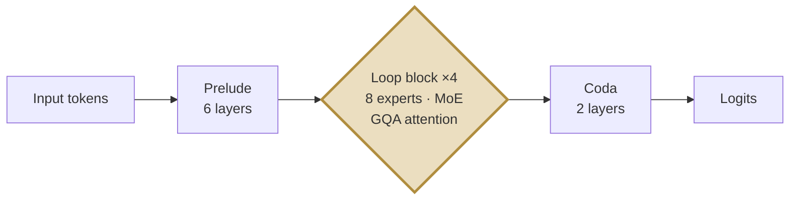
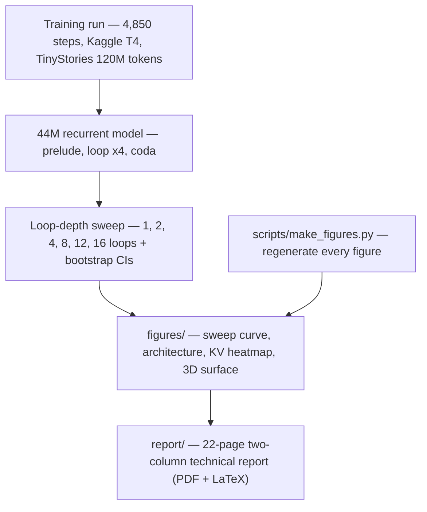

<div align="center">

# 🔁 Recurrent Small Language Models

### *Architecture, Training, and Evaluation — A Technical Report*

[](report/Recurrent_Small_LMs_Technical_Report_NeurIPS.pdf)
[]()
[]()

**One honest question, answered with real numbers:** *do recurrent transformers gain anything from running extra loops at test time?*

**Answer: no.** Perplexity cliff-dives from 29.4 → 4.4 as loops go 1 → 4 (the trained depth), then flatlines — 8, 12, 16 loops buy nothing. With 95% bootstrap confidence intervals to prove it.

</div>

---

## 📊 The centrepiece result


| Loops | 1 | 2 | **4 (trained)** | 8 | 12 | 16 |
|---|---|---|---|---|---|---|
| Perplexity | 29.38 | 11.18 | **4.41** | 4.90 | 4.91 | 4.91 |
| 95% CI | [28.30, 30.52] | [10.84, 11.54] | **[4.28, 4.55]** | [4.75, 5.06] | [4.76, 5.07] | [4.76, 5.07] |

The 4→8 degradation is real: paired per-sequence difference **+0.106 loss, CI [+0.101, +0.110]**. Test-time loop scaling saturates at the trained depth and slightly degrades beyond it.

### 🔥 In 3D


---

## 🏗️ The reference model




- **43,974,722 parameters** · dim 512 · GPT-2 BPE (50,257)
- Trained on TinyStories, 120M tokens, loss 9.52 → 1.53

---

## 🗺️ Why GQA matters: the KV-cache heatmap


At batch 8 / 2k context the MHA cache (403 MB) is **4× the weights** — GQA reclaims ~300 MB. At heavy batching it's the difference between fitting on one GPU or not.

---

## 📖 What's inside the report

| Section | Topic | Status |
|---|---|---|
| 3 | **Loop-depth extrapolation sweep** (the executed study) | ✅ Measured + bootstrap CIs |
| 4 | MoE routing dynamics · GQA efficiency · depth–width tradeoffs | 📐 Analytical |
| 5 | Curriculum protocol · loop-aware distillation | 📝 Proposed |
| 6 | Test-time compute taxonomy · quantization · mechanistic probes · TinyLoop-Bench | 📐/📝 Mixed |
| 7 | Conclusion + the key next experiment | 🎯 |

**Honesty rule:** proposed experiments are labelled as proposed. The only executed study is the loop sweep. CIs capture sampling noise over sequences — run-to-run seed variance is named as the next experiment.

---

## 📁 Repo layout

```
├── report/     → the 22-page two-column PDF + full LaTeX sources
├── figures/    → all diagrams (PNG)
└── scripts/    → make_figures.py (regenerate every figure from the data)
```

Regenerate figures: `python3 scripts/make_figures.py` (needs matplotlib + numpy).

---

<div align="center">

*Built from a real training run — 4,850 steps on a Kaggle T4, October 2026.*
**Jayant Dubey** · October 2026

</div>

---

## 🗺️ Project map



## 📊 At a glance (verified 30 Oct 2026)

| Measure | Value |
|---|---|
| Question | Do recurrent transformers gain anything from running extra loops at test time? |
| Answer | No — perplexity cliff-dives 29.4 → 4.4 from loops 1 → 4 (the trained depth), then flatlines |
| Sweep | Loops 1 / 2 / 4 / 8 / 12 / 16 → perplexity 29.38 / 11.18 / 4.41 / 4.90 / 4.91 / 4.91, with 95% bootstrap CIs |
| Beyond trained depth | 4 → 8 degrades for real: +0.106 loss, CI [+0.101, +0.110] |
| Reference model | 43,974,722 parameters, dim 512, GPT-2 BPE (50,257) |
| Architecture | Prelude (6 layers) → loop block ×4 (8 MoE experts, GQA attention) → coda (2 layers) → logits |
| Training | TinyStories, 120M tokens, loss 9.52 → 1.53; 4,850 steps on a Kaggle T4, October 2026 |
| GQA payoff | At batch 8 / 2k context the MHA cache (403 MB) is 4× the weights — GQA reclaims ~300 MB |
| Report | 22-page two-column technical report (PDF + full LaTeX sources in report/) |
| Honesty rule | Proposed experiments are labelled proposed; the only executed study is the loop sweep |
